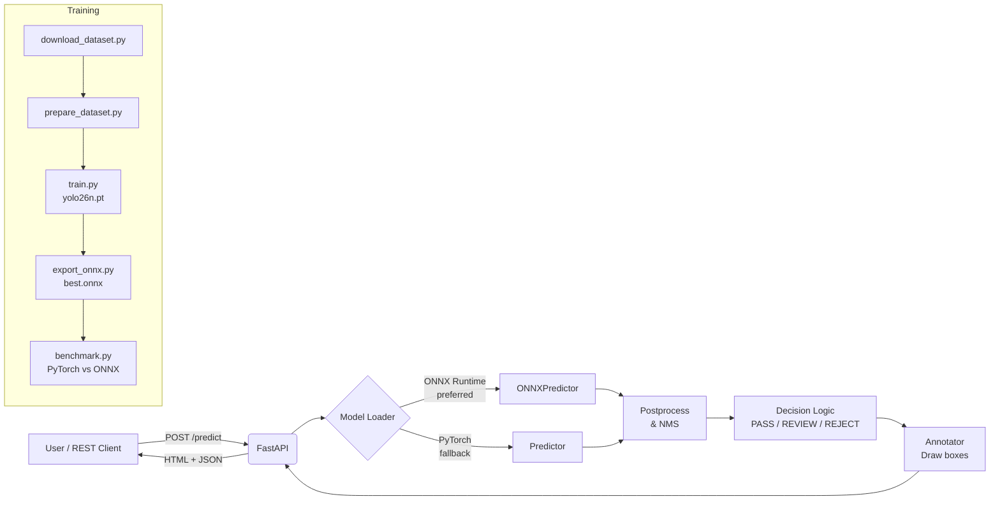

# Real-Time PCB Defect Inspection at the Edge using YOLO26

> **Portfolio project** — end-to-end computer vision system for automated PCB quality inspection.
> Trains a YOLO26 detection model on the DsPCBSD+ dataset to identify and localise 9 categories
> of PCB surface defects, then serves the model through a FastAPI web application and REST API
> for image upload, defect visualisation, and **PASS / REVIEW / REJECT** decisions.
> Optimised for CPU-first inference with ONNX Runtime and prepared for deployment on
> Oracle Cloud Always Free Arm instances.

---

## Why this matters

Manual optical inspection in electronics manufacturing is slow, inconsistent, and hard to scale.
This system automates the detection of PCB surface defects from images, providing fast and
repeatable quality decisions that match or exceed human-inspector consistency for the defect
categories present in the training data.

---

## Architecture



---

## Dataset — DsPCBSD+

| Property | Value |
|----------|-------|
| Total images | 10,259 |
| Total bounding boxes | 20,276 |
| Classes | 9 |
| Train / Val split | 8,208 / 2,051 |
| Annotation format | YOLO + COCO |
| License | CC BY 4.0 |

**Defect classes:**

| Code | Full name |
|------|-----------|
| SH   | Short |
| SP   | Spur |
| SC   | Spurious Copper |
| OP   | Open |
| MB   | Mouse Bite |
| HB   | Hole Breakout |
| CS   | Conductor Scratch |
| CFO  | Conductor Foreign Object |
| BMFO | Base Material Foreign Object |

**Important:** DsPCBSD+ contains **cropped local PCB defect images**, not full-board images.
Detection accuracy on full-board images in the wild may differ and should be validated separately.

**Dataset links:**
- Official page: https://figshare.com/articles/dataset/DsPCBSD_/24970329
- DOI: https://doi.org/10.6084/m9.figshare.24970329
- Direct download: https://figshare.com/ndownloader/files/44069552
- Dataset paper: https://www.nature.com/articles/s41597-024-03656-8

---

## Model — YOLO26

- Framework: [Ultralytics YOLO26](https://docs.ultralytics.com/models/yolo26/)
- Default variant: **yolo26n** (nano — fastest, smallest, edge-friendly)
- License: AGPL-3.0 (Ultralytics open-source license)
- Production format: **ONNX** (CPU inference via ONNX Runtime)

---

## Project structure

```
pcb-defect-yolo26/
├── configs/          dataset.yaml, train.yaml, app.yaml
├── data/
│   ├── raw/          dataset archive (not committed)
│   ├── processed/    Ultralytics-ready split (not committed)
│   └── samples/      demo images
├── src/
│   ├── data/         download, verify, prepare scripts
│   ├── training/     train, evaluate, export, benchmark
│   ├── inference/    predictor, onnx_predictor, decision_logic, schemas
│   ├── api/          FastAPI app, routes, services
│   ├── ui/           Jinja2 templates + static assets
│   └── utils/        logging, image_ops, metrics
├── tests/            pytest test suite
├── deploy/oracle/    deployment guide, scripts, Terraform
├── Dockerfile
├── docker-compose.yml
└── Makefile
```

---

## Quick start

### 1. Install dependencies

```bash
git clone <your-repo-url>
cd pcb-defect-yolo26
pip install -r requirements.txt
```

### 2. Download and prepare dataset

```bash
make download   # ~122 MB download from figshare
make prepare    # builds Ultralytics YOLO layout + configs/dataset.yaml
make verify     # optional: sanity-check image/label counts
```

### 3. Train

```bash
make train
# Defaults: yolo26n.pt, 640px, 100 epochs, patience=15, auto device
# Weights saved to: runs/train/yolo26n_pcb/weights/best.pt
```

Override defaults:
```bash
python src/training/train.py --epochs 50 --batch 8 --imgsz 416 --device cpu
```

### 4. Export to ONNX

```bash
make export
# Saves: runs/train/yolo26n_pcb/weights/best.onnx
```

### 5. Benchmark CPU latency

```bash
make benchmark
# Compares PyTorch vs ONNX Runtime on CPU (100 runs)
```

### 6. Run the web app

```bash
make serve
# Open http://localhost:8000
```

### 7. Run tests

```bash
make test
```

---

## API reference

### `GET /health`

```json
{
  "status": "ok",
  "model_loaded": true,
  "model_backend": "onnx",
  "version": "1.0.0"
}
```

### `POST /predict`

Upload a PCB image (JPEG, PNG, BMP, TIFF):

```bash
curl -X POST http://localhost:8000/predict \
  -F "file=@pcb_sample.jpg"
```

Response:
```json
{
  "filename": "pcb_sample.jpg",
  "image_width": 640,
  "image_height": 480,
  "board_status": "REJECT",
  "natural_language_summary": "Detected 2 defects: 1 Open, 1 Short. Board status: REJECT.",
  "detections": [
    {
      "class_id": 3,
      "class_name": "OP",
      "class_full_name": "Open",
      "confidence": 0.87,
      "bbox": {"x1": 120.5, "y1": 80.2, "x2": 200.1, "y2": 160.7}
    }
  ],
  "counts_by_class": {"OP": 1, "SH": 1},
  "max_conf_by_class": {"OP": 0.87, "SH": 0.72},
  "total_defects": 2,
  "inference_time_ms": 85.4,
  "annotated_image_b64": "iVBORw0KGgo..."
}
```

### `POST /predict/batch`

Upload multiple images at once:

```bash
curl -X POST http://localhost:8000/predict/batch \
  -F "files=@img1.jpg" -F "files=@img2.jpg"
```

Returns aggregated results + saves `runs/batch_results.csv`.

---

## Decision logic

| Condition | Status |
|-----------|--------|
| Any **OP** or **SH** detection above threshold | **REJECT** |
| Other defects detected above threshold | **REVIEW** |
| No detections above threshold | **PASS** |

Configure critical classes and thresholds in `configs/app.yaml` or via environment variables.

---

## Docker

```bash
make docker-build
make docker-run

# Or with docker compose:
docker compose up -d
```

The container expects model weights mounted at `./runs/` (see `docker-compose.yml`).

---

## Oracle Cloud deployment

See [`deploy/oracle/README.md`](deploy/oracle/README.md) for the full step-by-step guide.

**Summary:**
1. Provision an A1.Flex VM (2 OCPU, 12 GB RAM) — Always Free
2. Run `install_vm.sh` to bootstrap Docker
3. Copy your trained `best.onnx` to the VM
4. `docker compose up -d`
5. Open port 8000 in the security list

---

## Environment variables

Copy `.env.example` to `.env` and adjust:

| Variable | Default | Description |
|----------|---------|-------------|
| `ONNX_MODEL_PATH` | `runs/train/yolo26n_pcb/weights/best.onnx` | Production model |
| `PT_MODEL_PATH` | `runs/train/yolo26n_pcb/weights/best.pt` | PyTorch fallback |
| `CONF_THRESHOLD` | `0.25` | Detection confidence cutoff |
| `IOU_THRESHOLD` | `0.45` | NMS IoU threshold |
| `IMGSZ` | `640` | Inference image size |
| `CRITICAL_CLASSES` | `OP,SH` | Classes that trigger REJECT |

---

## Limitations

- **Cropped images**: DsPCBSD+ uses cropped local defect patches, not whole-board photos. Full-board generalisation requires additional fine-tuning.
- **9 defect classes**: Coverage is limited to the classes present in the dataset.
- **CPU inference**: Latency on a single-core CPU may be 500–1500 ms per image at 640px.
- **No temporal tracking**: Each image is inspected independently; no board-level session state.

---

## Future improvements

- Fine-tune on full-board images for production lines
- TensorRT / OpenVINO export path for faster edge inference
- Image history / inspection log UI
- GitHub Actions CI for lint + test
- Confidence calibration using temperature scaling

---

## Licensing

- **Dataset (DsPCBSD+)**: CC BY 4.0 — cite the [Scientific Data paper](https://www.nature.com/articles/s41597-024-03656-8)
- **YOLO26 / Ultralytics**: AGPL-3.0 — see [Ultralytics licensing](https://www.ultralytics.com/license)
- **This project**: MIT (see LICENSE_NOTES.md)

---

## Citation

If you use DsPCBSD+ in your work, please cite:

> Zhao, Y. et al. (2024). DsPCBSD+: A dataset for PCB surface defect detection. *Scientific Data*, 11, 747. https://doi.org/10.1038/s41597-024-03656-8
