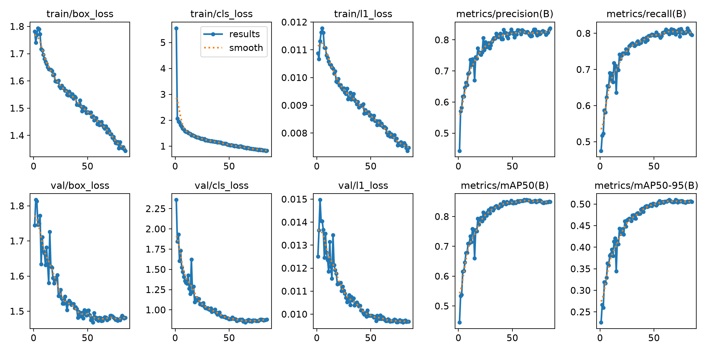
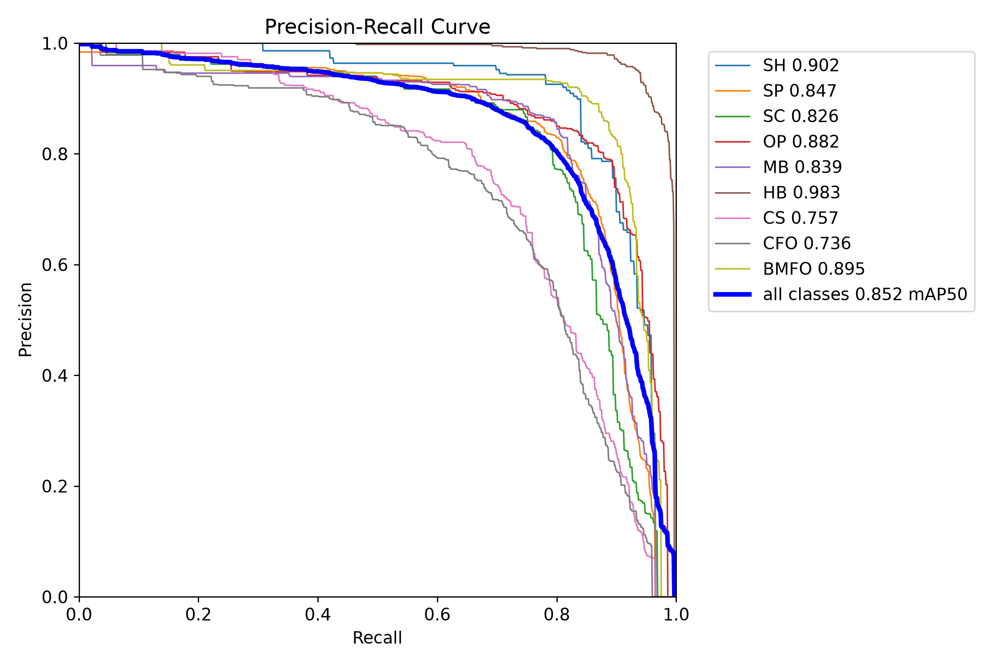
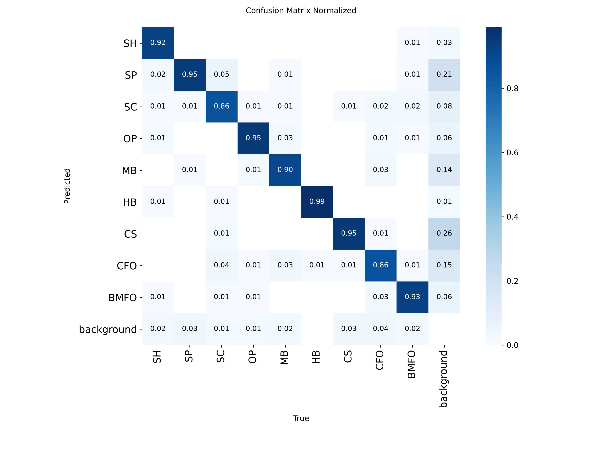
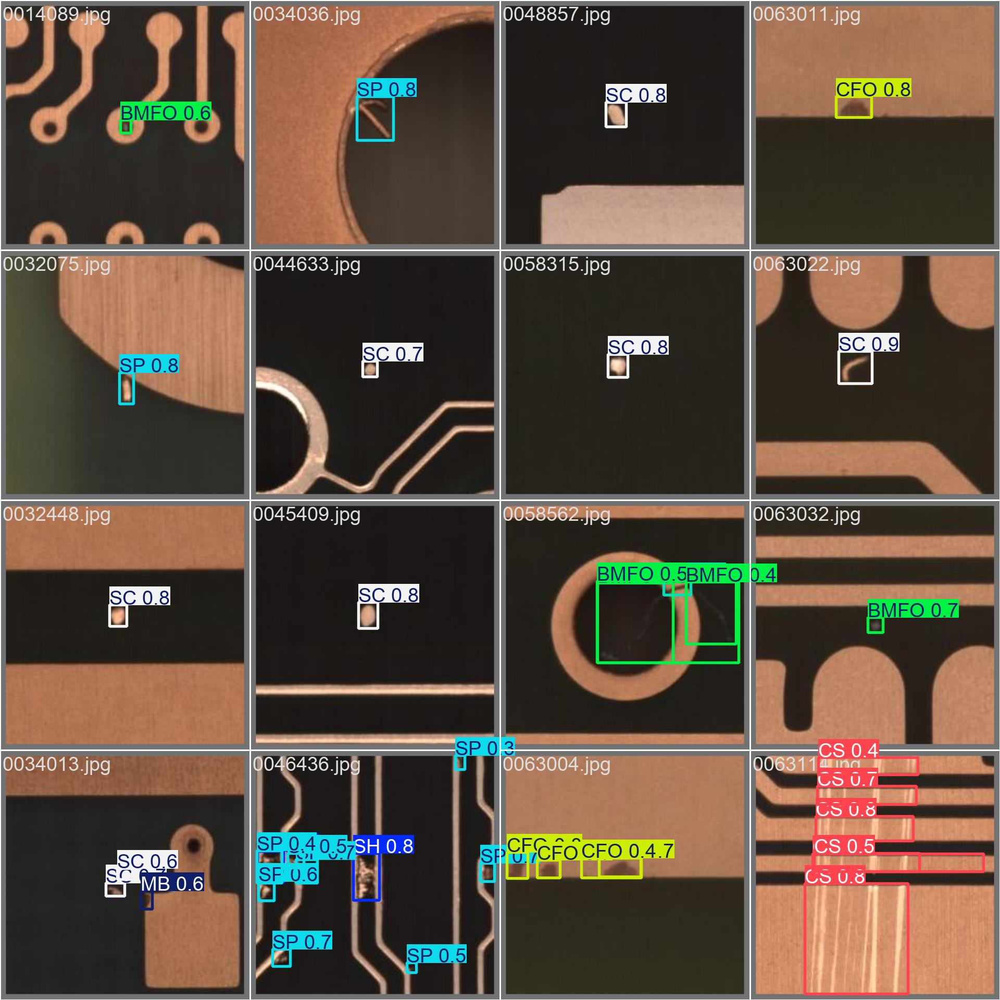
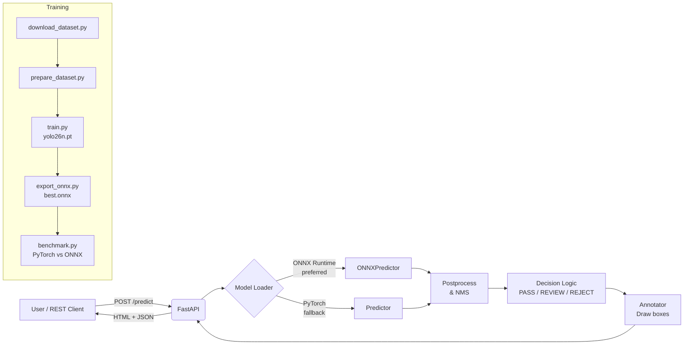

# Real-Time PCB Defect Inspection with YOLO26

Checking printed circuit boards by eye is slow, tiring and easy to get wrong on a long shift. This project automates that step. Upload an image of a PCB and it finds surface defects, draws boxes around them and gives the board a **PASS**, **REVIEW** or **REJECT** decision.

Under the hood it is a YOLO26-nano detector trained on the DsPCBSD+ dataset (9 defect types), served through a FastAPI web app and REST API. The model is also exported to ONNX so it runs well on CPU-only machines, and the repo includes a deployment guide for an Oracle Cloud Always Free Arm instance.

---

## Results at a glance

| Metric | Value |
|--------|-------|
| mAP@50 | **0.852** |
| mAP@50-95 | **0.510** |
| Precision | **0.835** |
| Recall | **0.796** |
| GPU inference (PyTorch, RTX 5060 Laptop) | **15.9 ms / image (~63 FPS)** |
| CPU inference (ONNX Runtime) | **62.1 ms / image (~16 FPS)** |
| Model size (ONNX) | **9.4 MB** |

All numbers are on the 2,051-image validation set (4,092 labelled defects) at 640×640.

---

## Training results

I trained `yolo26n` for up to 100 epochs at 640×640 with batch size 16 and early stopping (patience 15). Training ran on an NVIDIA RTX 5060 Laptop GPU at about 2.7 minutes per epoch. Early stopping ended the run at epoch 85, after roughly 2.2 hours, and the best checkpoint came from epoch 70.

### Per-class performance

| Class | Defect | Images | Instances | Precision | Recall | mAP@50 | mAP@50-95 |
|-------|--------|-------:|----------:|----------:|-------:|-------:|----------:|
| HB   | Hole Breakout                 | 271 | 608 | 0.910 | 0.951 | **0.983** | **0.829** |
| SH   | Short                         | 126 | 169 | 0.837 | 0.840 | 0.902 | 0.588 |
| BMFO | Base Material Foreign Object  | 305 | 346 | 0.859 | 0.881 | 0.895 | 0.462 |
| OP   | Open                          | 274 | 338 | 0.818 | 0.853 | 0.882 | 0.526 |
| SP   | Spur                          | 430 | 929 | 0.858 | 0.755 | 0.847 | 0.383 |
| MB   | Mouse Bite                    | 391 | 546 | 0.880 | 0.753 | 0.839 | 0.402 |
| SC   | Spurious Copper               | 245 | 285 | 0.822 | 0.782 | 0.826 | 0.504 |
| CS   | Conductor Scratch             | 279 | 448 | 0.776 | 0.679 | 0.757 | 0.467 |
| CFO  | Conductor Foreign Object      | 309 | 423 | 0.750 | 0.667 | 0.736 | 0.430 |
| **All** |                            | **2,051** | **4,092** | **0.835** | **0.796** | **0.852** | **0.510** |

Open (OP) and Short (SH) are the two defects that cause an automatic REJECT, and both score above 0.88 mAP@50.

### Inference speed

Each benchmark is 100 timed runs at 640×640:

| Backend | Device | Mean | p50 | p95 |
|---------|--------|-----:|----:|----:|
| PyTorch      | RTX 5060 Laptop GPU | 15.9 ms | 15.6 ms | 19.5 ms |
| ONNX Runtime | CPU                 | 62.1 ms | 62.2 ms | 66.8 ms |

That works out to about 63 images per second on the GPU and about 16 per second on the CPU, which is fast enough for real-time inspection either way.

### Training curves



### Precision-recall curve



### Confusion matrix (normalized)



### Sample predictions on the validation set



The per-epoch numbers are in [`docs/training_results.csv`](docs/training_results.csv) and the raw benchmark output is in [`docs/benchmark.json`](docs/benchmark.json).

---

## How it works



The API loads the ONNX model first and uses the PyTorch weights as a backup. Every request goes through detection, post-processing and the decision rules below. The response includes the annotated image along with the JSON results.

---

## Dataset: DsPCBSD+

| Property | Value |
|----------|-------|
| Total images | 10,259 |
| Total bounding boxes | 20,276 |
| Classes | 9 |
| Train / Val split | 8,208 / 2,051 |
| Image type | Close-up crops of PCB defect regions |
| Annotation format | YOLO + COCO |
| License | CC BY 4.0 |

**Defect classes**

| Code | Full name |
|------|-----------|
| SH   | Short |
| SP   | Spur |
| SC   | Spurious Copper |
| OP   | Open |
| MB   | Mouse Bite |
| HB   | Hole Breakout |
| CS   | Conductor Scratch |
| CFO  | Conductor Foreign Object |
| BMFO | Base Material Foreign Object |

**Links**
- Dataset page: https://figshare.com/articles/dataset/DsPCBSD_/24970329
- DOI: https://doi.org/10.6084/m9.figshare.24970329
- Direct download: https://ndownloader.figshare.com/files/44069552
- Paper: https://www.nature.com/articles/s41597-024-03656-8

---

## Model: YOLO26

- Framework: [Ultralytics YOLO26](https://docs.ultralytics.com/models/yolo26/)
- Variant: **yolo26n** (nano), chosen because it is small and fast enough for edge devices
- Deployment format: **ONNX**, run with ONNX Runtime
- License: AGPL-3.0

---

## Project structure

```
pcb-defect-yolo26/
├── configs/          dataset.yaml, train.yaml, app.yaml
├── data/
│   ├── raw/          dataset archive (not committed)
│   ├── processed/    Ultralytics-ready split (not committed)
│   └── samples/      demo images
├── docs/             result plots, training log and benchmark output
├── src/
│   ├── data/         download, verify, prepare scripts
│   ├── training/     train, evaluate, export, benchmark
│   ├── inference/    predictor, onnx_predictor, decision_logic, schemas
│   ├── api/          FastAPI app, routes, services
│   ├── ui/           Jinja2 templates + static assets
│   └── utils/        logging, image_ops, metrics
├── tests/            pytest test suite
├── deploy/oracle/    deployment guide, scripts, Terraform
├── Dockerfile
├── docker-compose.yml
└── Makefile
```

---

## Getting started

### 1. Install

```bash
git clone https://github.com/Mokshitha1303/PCB_Defect_Detection.git
cd PCB_Defect_Detection
python -m venv .venv
# Windows: .venv\Scripts\activate    macOS/Linux: source .venv/bin/activate
pip install -r requirements.txt
```

If you have an NVIDIA GPU, install the CUDA build of PyTorch before you install the requirements:

```bash
pip install torch torchvision --index-url https://download.pytorch.org/whl/cu128
```

### 2. Get the dataset

```bash
make download   # about 122 MB from figshare
make prepare    # builds the Ultralytics layout and configs/dataset.yaml
make verify     # optional: checks image and label counts
```

### 3. Train

```bash
make train
# Defaults: yolo26n.pt, 640px, 100 epochs, patience 15, picks the GPU automatically
# Best weights: runs/detect/runs/train/yolo26n_pcb/weights/best.pt
```

Any setting can be changed from the command line:

```bash
python src/training/train.py --epochs 50 --batch 8 --imgsz 416 --device cpu
```

### 4. Export to ONNX

```bash
make export
# Saves runs/detect/runs/train/yolo26n_pcb/weights/best.onnx
```

### 5. Benchmark

```bash
make benchmark
# Times PyTorch and ONNX Runtime over 100 runs and writes runs/benchmark.json
```

### 6. Run the web app

```bash
make serve
# Then open http://localhost:8000
```

### 7. Run the tests

```bash
make test
```

---

## API reference

### `GET /health`

```json
{
  "status": "ok",
  "model_loaded": true,
  "model_backend": "onnx",
  "version": "1.0.0"
}
```

### `POST /predict`

Upload a PCB image (JPEG, PNG, BMP or TIFF):

```bash
curl -X POST http://localhost:8000/predict \
  -F "file=@pcb_sample.jpg"
```

Response:

```json
{
  "filename": "pcb_sample.jpg",
  "image_width": 640,
  "image_height": 480,
  "board_status": "REJECT",
  "natural_language_summary": "Detected 2 defects: 1 Open, 1 Short. Board status: REJECT.",
  "detections": [
    {
      "class_id": 3,
      "class_name": "OP",
      "class_full_name": "Open",
      "confidence": 0.87,
      "bbox": {"x1": 120.5, "y1": 80.2, "x2": 200.1, "y2": 160.7}
    }
  ],
  "counts_by_class": {"OP": 1, "SH": 1},
  "max_conf_by_class": {"OP": 0.87, "SH": 0.72},
  "total_defects": 2,
  "inference_time_ms": 62.1,
  "annotated_image_b64": "iVBORw0KGgo..."
}
```

### `POST /predict/batch`

Send several images in one request:

```bash
curl -X POST http://localhost:8000/predict/batch \
  -F "files=@img1.jpg" -F "files=@img2.jpg"
```

It returns combined results for all the images and saves them to `runs/batch_results.csv`.

---

## Decision logic

| Condition | Status |
|-----------|--------|
| Any **OP** or **SH** detection above the threshold | **REJECT** |
| Any other defect above the threshold | **REVIEW** |
| Nothing above the threshold | **PASS** |

You can change the critical classes and thresholds in `configs/app.yaml` or with environment variables.

---

## Docker

```bash
make docker-build
make docker-run

# or with docker compose
docker compose up -d
```

The container expects the trained weights to be mounted under `./runs/` (see `docker-compose.yml`).

---

## Deploying to Oracle Cloud

The full walkthrough is in [`deploy/oracle/README.md`](deploy/oracle/README.md). In short:

1. Create an A1.Flex VM (2 OCPU, 12 GB RAM) on the Always Free tier.
2. Run `install_vm.sh` to set up Docker.
3. Copy your trained `best.onnx` to the VM.
4. Run `docker compose up -d`.
5. Open port 8000 in the security list.

---

## Environment variables

Copy `.env.example` to `.env` and change what you need:

| Variable | Default | Description |
|----------|---------|-------------|
| `ONNX_MODEL_PATH` | `runs/detect/runs/train/yolo26n_pcb/weights/best.onnx` | Main model |
| `PT_MODEL_PATH` | `runs/detect/runs/train/yolo26n_pcb/weights/best.pt` | PyTorch backup |
| `CONF_THRESHOLD` | `0.25` | Minimum detection confidence |
| `IOU_THRESHOLD` | `0.45` | NMS IoU threshold |
| `IMGSZ` | `640` | Inference image size |
| `CRITICAL_CLASSES` | `OP,SH` | Classes that trigger REJECT |

---

## What's next

- Fine-tune on full-board images from a production line
- Add TensorRT and OpenVINO exports for even faster edge inference
- Add an inspection history page to the UI
- Set up GitHub Actions for linting and tests
- Calibrate confidence scores with temperature scaling

---

## Licensing

- **Dataset (DsPCBSD+)**: CC BY 4.0. Please cite the [Scientific Data paper](https://www.nature.com/articles/s41597-024-03656-8).
- **YOLO26 / Ultralytics**: AGPL-3.0. See [Ultralytics licensing](https://www.ultralytics.com/license).
- **This project**: MIT. See [LICENSE_NOTES.md](LICENSE_NOTES.md).

---

## Citation

If you use DsPCBSD+ in your work, please cite:

> Zhao, Y. et al. (2024). DsPCBSD+: A dataset for PCB surface defect detection. *Scientific Data*, 11, 747. https://doi.org/10.1038/s41597-024-03656-8
